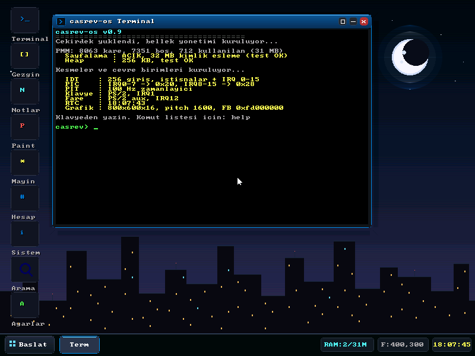
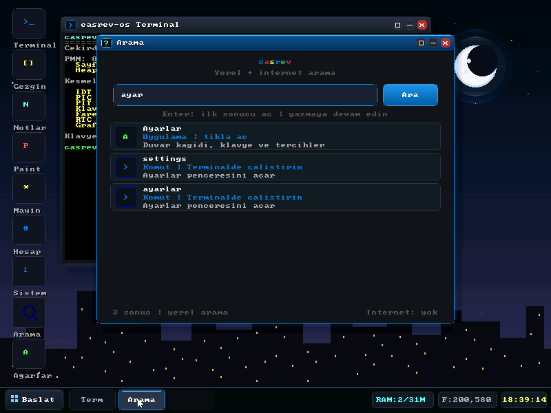

# casrev-os

Sıfırdan, adım adım geliştirilen küçük bir x86 işletim sistemi.

Her aşama çalışır durumda bırakılır: derle, QEMU'da aç, sonucu gör.

> Proje konumu: `C:\Users\smmav\OneDrive\Desktop\casrev-os`
>
> GitHub: <https://github.com/Volkanas/casrev-os>





## Hızlı başlangıç

**`BASLAT.bat`** dosyasına çift tıklayın. Proje derlenir ve QEMU penceresi açılır.

Kapatmak için QEMU penceresini kapatmanız yeterli.

## Gereksinimler

| Araç | Kurulum |
|------|---------|
| NASM | `winget install NASM.NASM` |
| QEMU | `winget install SoftwareFreedomConservancy.QEMU` |
| LLVM (clang + lld) | `winget install LLVM.LLVM` |
| PowerShell | Windows ile gelir |

## Komut satırından

```powershell
cd "C:\Users\smmav\OneDrive\Desktop\casrev-os"
powershell -ExecutionPolicy Bypass -File scripts/build.ps1
powershell -ExecutionPolicy Bypass -File scripts/run.ps1
```

Pencere açmadan (seri çıktı konsola gelir):

```powershell
powershell -ExecutionPolicy Bypass -File scripts/run.ps1 -NoDisplay
```

Testler:

```powershell
powershell -ExecutionPolicy Bypass -File scripts/test.ps1           # açılış + bellek
powershell -ExecutionPolicy Bypass -File scripts/test-shell.ps1     # klavye + fare + kabuk
powershell -ExecutionPolicy Bypass -File scripts/test-gui.ps1       # masaüstü + Not Defteri
powershell -ExecutionPolicy Bypass -File scripts/test-settings.ps1  # Ayarlar + pencere yönetimi + Türkçe tuşlar
powershell -ExecutionPolicy Bypass -File scripts/test-search.ps1    # yerel Arama: dosya, uygulama, komut
```

`test-shell.ps1`, `test-settings.ps1` ve `test-search.ps1` QEMU monitor üzerinden
gerçek tuş basışları ve fare hareketleri gönderir. `test-settings.ps1` ayrıca
duvar kağıdı değiştirme, büyütme/geri yükleme, küçültme, görev çubuğundan geri
açma, sekiz uygulama açıkken görev çubuğu yerleşimi, Başlat menüsü hover'ı ve
Türkçe karakter yazımını ekran görüntüleriyle doğrular
(`build/settings-*.png`). `test-search.ps1`, RamFS dosyası (`gorevler.txt`),
uygulama (Ayarlar) ve kabuk komutu (`help`) sonuçlarını açıp ekran görüntüleriyle
kaydeder (`build/search-*.png`).

## Modern Masaüstü ve Uygulamalar (v0.9, 16-bit)

- **VESA Mode 0x114:** 800×600, 65.536 renk (RGB565), 16-bit doğrusal (LFB) framebuffer; eski palet renkleri uyumluluk için RGB565'e eşlenir.
- **16-bit görsel katman:** Tam renkli gradyan duvar kağıtları, yumuşak pencere gölgeleri, yarı saydam görev çubuğu/Başlat menüsü ve gradyan başlık çubukları.
- **Etkileşim cilâsı:** Masaüstü simgeleri, Başlat menüsü öğeleri ve pencere düğmeleri için hover vurguları.
- **Dokuz yerleşik uygulama:** Terminal, Dosya Gezgini, Not Defteri, Paint, Mayın Tarlası, Hesap Makinesi, Sistem Bilgisi, Arama ve Ayarlar.
- **Pencere yönetimi:**
  - Pencereler başlık çubuğundan sürüklenebilir.
  - `[-]` küçültür, `[ ]` büyütür/geri yükler, `[x]` kapatır.
  - Başlık çubuğuna çift tıklama da büyütür/geri yükler.
  - Tıklanan pencere öne gelir (Z-order) ve klavye odağını alır.
- **Ayarlar uygulaması:**
  - Dört duvar kağıdı: Gece, Okyanus, Gün Batımı, Klasik; seçim anında uygulanır.
  - Türkçe-Q klavye bilgisi ve AltGr sembolleri.
  - Pencere büyütüldüğünde geniş yerleşim, kısayollar ve canlı sistem durumu paneli.
- **Görev çubuğu:**
  - Modern "Başlat" butonu (ESC veya fare ile açılır).
  - Açık pencereler için dinamik genişlikte sekmeler; tıklayınca küçült/geri aç.
  - Sistem tepsisi: canlı PMM RAM kullanımı (`RAM: X/31M`), fare koordinatları ve RTC saati.
- **Başlat menüsü:** Yarı saydam koyu panel, hover vurgulu dokuz uygulama, yeniden başlat ve kapat.
- **Yerel Arama:** Google görünümlü, tamamen çevrimdışı arama penceresi; RamFS dosyalarını, uygulamaları ve kabuk komutlarını tarar.
- **Dört duvar kağıdı:** 16-bit gradyanlı yıldızlı gece silueti, okyanus, gün batımı ve sade klasik tema.
- **Sanal Dosya Sistemi (RamFS):** Bellek içi klasör/dosya hiyerarşisi; Dosya Gezgini ve Not Defteri ile düzenlenebilir.

> **Not:** Dosyalar şu an RamFS üzerinde tutulur; yeniden başlatınca sıfırlanır.
> Kalıcı depolama (ATA/FAT12) yol haritasındadır.

### Uygulamalar

1. **Terminal:** Tam özellikli interaktif komut kabuğu.
2. **Dosya Gezgini:** Klasörler arasında gezinme (`< Geri`), dosya boyutları, tıklamayla Not Defterinde açma, yeni not oluşturma.
3. **Not Defteri:** Canlı imleçle yazma, dosya açma/düzenleme, `Kaydet` ve `Temizle`; Türkçe karakterleri özel gliflerle gösterir.
4. **Paint / Çizim Tahtası:** 8 renkli palet, 3 fırça boyutu (`1px`, `3px`, `5px`), silgi, fare ile serbest çizim.
5. **Mayın Tarlası:** 9×9 ızgara, 10 mayın, sayaç, gülen yüz sıfırlama, sol tıkla açma, sağ tıkla bayrak.
6. **Hesap Makinesi:** Tıklanabilir butonlar ve klavye desteği, LCD ekran.
7. **Sistem Bilgisi:** CPU tick, çalışma süresi, donanım durumları ve canlı RAM doluluk çubuğu.
8. **Arama (Yerel):** Google'a benzeyen sade arayüz; yazarken RamFS dosya adı/yolu/içeriği, uygulamalar ve kabuk komutları arasında anında arama. Dosya sonucu Not Defterinde, uygulama sonucu ilgili pencerede, komut sonucu Terminalde açılır. İnternet bağlantısı gerektirmez.
9. **Ayarlar:** Duvar kağıdı seçimi, klavye bilgisi, kısayollar ve canlı sistem durumu.

## Türkçe-Q klavye

Varsayılan düzen **Türkçe-Q (KBDTUQ)**'dur. Ulusal karakterler ISO-8859-9 /
Windows-1254 kodlarıyla üretilir ve 8×8 özel gliflerle çizilir.

| Fiziksel tuş (US etiketi) | Normal | Shift |
|---------------------------|--------|-------|
| `[` | ğ | Ğ |
| `]` | ü | Ü |
| `;` | ş | Ş |
| `'` | i | İ |
| `,` | ö | Ö |
| `.` | ç | Ç |
| `i` | ı | I |
| `/` | . | : |
| `\` | , | ; |
| `` ` `` | \ | " |

- **AltGr:** `@ # $ { } [ ] | \ ~ < >`
- `Caps Lock`, `Shift`, `Backspace`, `Enter` ve `ESC` çalışır.
- Kabuk komutları Türkçe karakterlerden ASCII'ye normalize edilir; örneğin
  `ayarlar` ve `settings` aynı komutu açar.
- Not Defteri'nde `ğ ü ş i ö ç ı` ve büyük karşılıkları doğrudan yazılabilir.

## Kabuk komutları

| Komut | Açıklama |
|-------|----------|
| `help` | Komut listesi |
| `clear` | Terminali temizler |
| `ls [yol]` | Dizindeki dosya ve klasörleri listeler |
| `cd <yol>` | Dizini değiştirir |
| `pwd` | Geçerli dizini yazdırır |
| `cat <dosya>` | Dosya içeriğini ekrana basar |
| `mkdir <klasor>` | Yeni klasör oluşturur |
| `touch <dosya>` | Yeni boş dosya oluşturur |
| `explorer` | Dosya Gezginini açar |
| `notepad [dosya]` | Not Defterini açar |
| `paint` | Paint çizim tahtasını açar |
| `mines` | Mayın Tarlası oyununu açar |
| `calc` | Hesap Makinesi penceresini açar |
| `sysinfo` | Sistem Bilgisi penceresini açar |
| `settings`, `ayarlar` | Ayarlar penceresini açar |
| `search [sorgu]`, `arama` | Yerel arama penceresini açar; sorgu verilirse sonuçları hazırlar |
| `launcher` | Başlat menüsünü açar/kapatır (ESC) |
| `uptime` | Çalışma süresi ve tick sayısı |
| `echo ...` | Metni ekrana yazar |
| `mem` | PMM / sayfalama / heap istatistikleri |
| `frame` | Bir fiziksel kare ayırır, yazar-okur, geri verir |
| `heap` | `kmalloc` / `kfree` testi |
| `time` | RTC tarih/saat bilgisi |
| `mouse` | Fare konumu ve düğme durumu |
| `about` | Sistem bilgisi |
| `reboot` | Sistemi yeniden başlatır |
| `halt` | Sistemi durdurur |

## Yol haritası

- [x] **Aşama 1** — 512 baytlık boot sector, BIOS ile ekrana yazma
- [x] **Aşama 2** — Diskten stage2 yükleme, A20, GDT ve 32-bit protected mode
- [x] **Aşama 3** — C çekirdeği, VGA sürücüsü, seri port, `kprintf`
- [x] **Aşama 4** — IDT, PIC yeniden eşleme, PIT 100 Hz, PS/2 klavye, kabuk
- [x] **Aşama 5** — E820 bellek haritası, bitmap PMM, sayfalama, `kmalloc`
- [x] **Aşama 6** — Grafik arayüz, BIOS fontu, RTC saati, PS/2 fare
- [x] **Aşama 7** — Modern Masaüstü GUI, pencereli Terminal, görev çubuğu, Başlat menüsü, Hesap Makinesi, Sistem Monitörü
- [x] **Aşama 8** — Sanal Dosya Sistemi (RamFS), Dosya Gezgini, Not Defteri, Paint, Mayın Tarlası
- [x] **Aşama 8.5 (v0.9)** — Tam Türkçe-Q klavye, Ayarlar uygulaması, dört duvar kağıdı, 16-bit RGB565 görsel paket, büyütme/geri yükleme
- [x] **Aşama 8.6** — Google görünümlü yerel Arama: RamFS dosyaları, uygulamalar ve kabuk komutları arasında çevrimdışı arama
- [ ] **Aşama 9** — Kalıcı dosya sistemi (ATA/FAT12), dosyaların yeniden başlatmada korunması
- [ ] **Aşama 10** — Süreçler, görev değiştirme, sistem çağrıları
- [ ] **Aşama 11** — Daha fazla uygulama, kararlılık ve performans çalışmaları

## Dizin yapısı

```
casrev-os/
├── BASLAT.bat               # çift tıkla: derle + QEMU
├── docs/
│   ├── stage10.png          # v0.9 16-bit masaüstü ekran görüntüsü
│   └── arama.png            # yerel Arama uygulaması ekran görüntüsü
├── src/
│   ├── boot/
│   │   ├── boot.asm         # boot sector
│   │   └── stage2.asm       # E820, VESA 0x114 (16-bit), font, A20, GDT, protected mode
│   └── kernel/
│       ├── entry.asm        # 32-bit giriş: yığın + .bss
│       ├── kernel.c         # kernel_main
│       ├── interrupts.asm   # 48 kesme girişi + ortak yol
│       ├── idt.c/.h         # IDT, PIC, istisna/IRQ dağıtımı
│       ├── timer.c/.h       # PIT 100 Hz
│       ├── keyboard.c/.h    # Türkçe-Q PS/2 scancode -> CP1254, ring buffer
│       ├── mouse.c/.h       # PS/2 aux fare, IRQ12, 3 baytlık paket
│       ├── rtc.c/.h         # CMOS saat/tarih, BCD ve 12 saat dönüşümü
│       ├── gfx.c/.h         # VESA LFB, RGB565 arka tampon, eski palet LUT'u, gradyan/gölge/alfa
│       ├── ui.c/.h          # masaüstü, pencereler, Arama, Ayarlar, terminal, fare imleci
│       ├── shell.c/.h       # satır düzenleme + komutlar
│       ├── bootinfo.h       # E820 / font / framebuffer boot_info_t
│       ├── pmm.c/.h         # fiziksel kare yöneticisi (bitmap)
│       ├── paging.c/.h      # 4 KB sayfalama, kimlik eşleme
│       ├── heap.c/.h        # kmalloc/kfree (256 KB)
│       ├── vfs.c/.h         # RamFS: düğümler, dosyalar, klasörler
│       ├── vga.c/.h         # grafik terminal üzerinden eski VGA API'si
│       ├── serial.c/.h      # COM1 115200 8N1
│       ├── console.c/.h     # VGA + seri ortak çıktı, kprintf
│       ├── string.c/.h      # memcpy/memset/strlen...
│       ├── io.h             # inb/outb
│       ├── types.h          # sabit genişlikli tipler
│       └── linker.ld        # çekirdek 0x100000'e bağlanır
├── scripts/
│   ├── build.ps1
│   ├── run.ps1
│   ├── test.ps1
│   ├── test-shell.ps1
│   ├── test-gui.ps1
│   ├── test-settings.ps1
│   └── test-search.ps1
├── build/                   # üretilen dosyalar (git'e girmez)
└── README.md
```

## Disk yerleşimi (1.44 MB disket imajı)

| Sektör | İçerik | Yüklenme adresi |
|--------|--------|-----------------|
| 0 | boot sector | `0x7C00` |
| 1–4 | stage2 | `0x7E00` |
| 5+ | `kernel.bin` | önce `0x10000`, sonra `0x100000` |

## Teknik notlar

- Hedef: **i386 (x86 32-bit)**, BIOS/MBR önyükleme, QEMU `qemu-system-i386`.
- Boot sector `0x7C00`, 512 bayt, son 2 baytı `0xAA55`.
- Çekirdek `0x10000`'e yüklenir, protected mode'da `0x100000`'e kopyalanır.
- C çekirdek `--target=i386-elf -ffreestanding` ile derlenir; libc yoktur.
- IDT 256 giriş; 0–31 CPU istisnaları, 32–47 IRQ'lar.
- PIC: master `0x20`, slave `0x28`; IRQ0 (PIT), IRQ1 (klavye), IRQ2 (kaskad)
  ve IRQ12 (fare) açıktır.
- PIT kanal 0, mod 3, 100 Hz (`1193182 / 100`).
- Klavye scancode set 1; Türkçe-Q eşlemesi ve 256 baytlık IRQ ring buffer.
  AltGr sağ Alt tuşuna (`E0 38`) bağlıdır.
- **Grafik:** VESA mode 0x114 (`int 10h AX=4F02 BX=4114`), 800×600×16,
  RGB565 doğrusal framebuffer (LFB). LFB adresi ve pitch `boot_info_t` içinden
  alınır (QEMU'da LFB `0xFD000000`, pitch `1600`).
  Çizimler 1024×768×16 bit boyutlu arka tamponda yapılır; `gfx_flush()` her
  karede yalnızca 800×600'lük görünür bölümü pitch'e uygun olarak kopyalar.
  UI yalnızca kirli bayrak set edildiğinde yeniden çizilir.
- **16-bit renk:** Eski 8-bit palet indeksleri `legacy_lut[256]` ile RGB565'e
  eşlenir (0–15 VGA, 16–31 modern UI, 32–247 6×6×6 küp, 248–255 gri).
  Yeni duvar kağıdı, gölge ve vurgular `gfx_rgb()` / `GFX_RGB565()` ile tam
  renkli çizilir; alfa karışımı, dikey gradyan (4 satırlık dither) ve dokuz
  katmanlı yumuşak gölge yardımcıları `gfx.c` içindedir.
- **Font:** BIOS `int 10h AX=1130 BH=0` ile 8×8 font `0x9300`'e kopyalanır;
  başarısız olursa `F000:FA6E` adresine düşülür. Türkçe karakterler için
  `gfx.c` içinde 12 adet özel 8×8 glif bulunur.
- **Fare:** 8042 aux portu, IRQ12, 3 baytlık PS/2 paketi. Klavye ve fare
  baytlarını ayırmak için 8042 durum portunun 5. biti (`0x20`, AUX data)
  kontrol edilir.
- **RTC:** CMOS `0x70/0x71`; güncelleme bayrağı beklenir, BCD ve 12 saat
  modu dönüştürülür.
- **Bellek haritası:** `boot_info_t` `0x8F00`'da (32 bayt), E820 girişleri
  `0x8F40`'tan itibaren (32 × 24 bayt), BIOS fontu `0x9300`'de durur.
- **PMM:** 4 KB kareler, 4 GB'a kadar bitmap (`128 KB`), kullanılabilir
  bölgeler E820 tip 1'den işaretlenir; ilk 1 MB ve çekirdek imajı rezerve edilir.
- **Sayfalama:** 4 KB sayfalar, ilk 32 MB kimlik eşlemesi (identity map),
  `CR0.PG` ile açılır; `CR3` sayfa dizinini gösterir.
- **Heap:** çekirdek `.bss` içinde 256 KB, blok başlıklı first-fit allocator;
  `kfree` komşu boş blokları birleştirir.
- **RamFS:** Dinamik düğümler heap üzerinde; dosya içerikleri `kmalloc` ile
  tutulur. Kalıcı değildir.
- **Yerel Arama:** `ui.c` içindeki `search_run()` önce uygulama adı/açıklamasını,
  sonra RamFS ağacını (dosya adı, tam yol ve içerik), sonra kabuk komutlarını
  tarar. Türkçe karakterler `search_fold()` ile ASCII'ye katlanır; büyük/küçük
  harf duyarsızdır. En fazla beş sonuç gösterilir, dosya eşleşmelerinde içerikten
  tek satırlık bağlam özeti çıkarılır. Ağ katmanı yoktur; tamamen çevrimdışıdır.
- Test çıktısı hem grafik terminale hem COM1'e yazılır; test betikleri QEMU
  `sendkey`, `mouse_move` ve `mouse_button` ile gerçek girişleri gönderip
  sonucu seri porttan ve ekran görüntülerinden doğrular.
